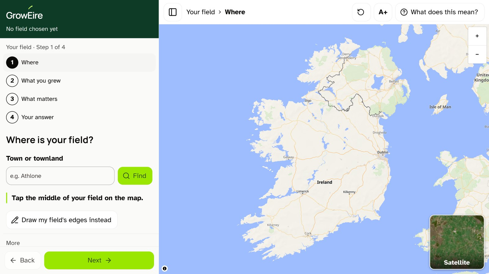
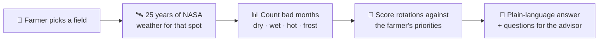

  

  
  
  

<h1 align="center">GrowÉire</h1>

  <b>Know your land. Grow your future.</b> 
  A free, plain-language tool that helps farmers choose a crop rotation that copes with a changing climate, using 25 years of open NASA Earth data.

  

  <a href="https://groweire.vercel.app/"><b>Try it live</b></a> ·
  <a href="#-how-it-works">How it works</a> ·
  <a href="#-tech-stack">Tech stack</a> ·
  <a href="docs/TECHNICAL.md">Technical guide</a> ·
  <a href="https://github.com/h0pers/nasa-hackathon-2026">Original hackathon repo</a>

  

> [!NOTE]
> **A quick word on this repo.** GrowÉire was built in one weekend by team KIPISH at NASA Space Apps 2026 (Hack Athlone, Ireland). This is a lightly polished copy of that project, tidied up mainly so it can be hosted and used online (now live at **[groweire.vercel.app](https://groweire.vercel.app/)**): a clearer map, sharper NASA satellite imagery, smoother mobile layout and a few bug fixes. The original hackathon code lives at **[h0pers/nasa-hackathon-2026](https://github.com/h0pers/nasa-hackathon-2026)**.

---

## 🌱 What it does

Every year a farmer decides what to grow, and in what order. One bad season can cost a whole year's income, and healthy soil takes years to rebuild. Yet that choice is usually made from habit, with no easy way to see how the weather on *their own field* has really behaved.

GrowÉire turns space data into something a farmer can read in five minutes on a phone:

- **📍 Find your field.** Search a town or tap the map, then mark or draw your field.
- **🌦️ See your weather history.** For each month, how often it has been too dry, too wet, too hot or frosty over the last 25 years, in plain numbers anyone can check against their own memory.
- **🔄 Compare rotations.** Your current rotation side by side with two or three alternatives, each with its benefits, risks and gaps.
- **🧑‍🌾 Talk it through.** A printable summary and questions to take to your farm advisor.

**Why it's cool:** it takes complex satellite and climate datasets and answers one human question in plain words: *"What should I grow next, and what could go wrong?"* It supports the farmer's own judgement and never replaces it.

## 🛰️ The challenge we chose

We took on **[Field Shift: Adapting Farms with NASA Data](https://www.spaceappschallenge.org/2026/challenges/adapting-farms-with-nasa-data/)**, which asks for a decision-support tool that uses NASA Earth observations to help farmers explore crop rotations that protect soil, save water and build resilience.

**Why this one?**
- **It's a real decision for real people.** We were in Athlone, in the middle of Irish farming country, where a record-wet spring was followed by the driest July on record. Rotation choice suddenly matters a lot.
- **NASA data is a perfect fit.** Decades of free global weather and satellite records can show patterns that one person's memory can't.
- **It works anywhere.** The core runs on global NASA data. Ireland is our first "pilot region", with Irish crops, soils and farming rules.

## 🧭 How it works

1. **Weather history.** The backend fetches daily data for the field from **NASA POWER** and models soil moisture with Met Éireann's soil-moisture-deficit method.
2. **Counted risk.** Simple, transparent rules count how often each month went wrong over 25 years, with an honest margin of error. No black box.
3. **Rotation comparison.** A catalogue of Irish crops and evidence (Teagasc guidance, FAO-56 water use) scores each option against what matters most to the farmer.
4. **Maps.** Clear satellite views from **NASA GIBS** (HLS Sentinel-2 at 30 m, over NASA Blue Marble) help farmers find and outline their field.

## 🧰 Tech stack

| Layer | Tools |
|---|---|
| **Frontend** | Vue 3, TypeScript, Vite, Tailwind CSS 4, shadcn-vue, Pinia, MapLibre GL |
| **Backend** | Python 3.12, FastAPI, Pydantic, SQLAlchemy, Alembic |
| **Data** | PostgreSQL + PostGIS, Redis cache, a shared `uv` workspace for the API and the data package |
| **NASA data** | POWER (daily weather), GPM IMERG (rainfall), MODIS & SMAP (vegetation, soil moisture), GIBS imagery (HLS, Blue Marble) |
| **Other open data** | ISRIC SoilGrids, OpenStreetMap, Irish soil and rotation guidance |

**Architecture in one sentence:** a Vue single-page app talks to a FastAPI service over `/api/v1`; the service pulls live NASA weather, applies the risk rules, caches results in PostGIS/Redis, and returns plain-language answers. The full diagram, API reference and data notes are in the **[technical guide](docs/TECHNICAL.md)**.

**How we built it:** we started with a machine-learning model for "crop stress", tested it honestly, and found that simple counted rules were clearer and more trustworthy for farmers. So the live app explains its numbers instead of hiding them, and the ML work stays in [`ml/`](ml/) for anyone curious.

## 🚀 Live demo

GrowÉire is live at [groweire.vercel.app](https://groweire.vercel.app/).

Search a town, mark your field, or press Explore an example farm.

## 👥 Team KIPISH

Built at NASA Space Apps 2026, Hack Athlone, by **Dmytro** ([@h0pers](https://github.com/h0pers)), **Vlad** ([@vzakh](https://github.com/vzakh)) and **Valeriia**.

This hosted version and repository are maintained by **[@vzakh](https://github.com/vzakh)**. Questions or ideas? Open an issue or email **vladyslav.zakh27@gmail.com**.

## 📄 Licence and data

- Code: **[MIT](LICENSE)**.
- Data: every dataset, its licence and the required credit wording are listed in **[REFERENCES.md](REFERENCES.md)**. NASA data is used under NASA's open data policy; OpenStreetMap data is © OpenStreetMap contributors (ODbL).

---

## ⚖️ Disclaimer

GrowÉire is an independent project created by participants of the NASA Space Apps Challenge 2026. It is not affiliated with, endorsed by, sponsored by or otherwise officially connected to the National Aeronautics and Space Administration (NASA) or any other U.S. government agency, and nothing in this repository or the hosted site should be read as implying such a relationship. "NASA" and the NASA insignia are trademarks of NASA; this project does not use the NASA insignia and claims no ownership of, or rights in, any NASA name, trademark, logo or copyrighted material. The NASA Space Apps Challenge name and logo are shown only to identify the event at which this project was created. The project uses publicly available NASA data in line with NASA's data and media usage guidelines and credits it as requested; all such data remains the property of its respective providers. GrowÉire is a decision-support aid only, provided "as is" without warranty of any kind; it does not replace professional agronomic advice.
